# Putting the new Domebox online — a simple book

> **The same book with pictures, ready to print: [`DEPLOY-BOOK.pdf`](DEPLOY-BOOK.pdf).**

Read one step. Do it. Tick the box. Then go to the next step.
Do not skip. Do not do two steps at once.

---

## Chapter 0 — First, understand what you have

You already have **two Google Sheets**:

| Your sheet | What it is | Like… |
|---|---|---|
| **Template sheet** | An empty pattern. When a new company signs up, Domebox makes a copy of it for them. | A blank exam paper that gets photocopied for every student |
| **Master sheet** | The list of every company, their login, their plan. It also has your **OLD script** inside it. | The school register |

And every customer has **their own sheet** with their tasks. That is their data.

### The three rules of this book

1. **Never change the OLD script** inside your Master sheet. It is your live
   website right now. Your customers are using it. Leave it alone.
2. **Never open or edit a customer's sheet.** The new script does that safely.
3. The **NEW script** does **not** go inside any sheet. It gets its **own
   separate place**, called a *project*. You will make it in Step 3.

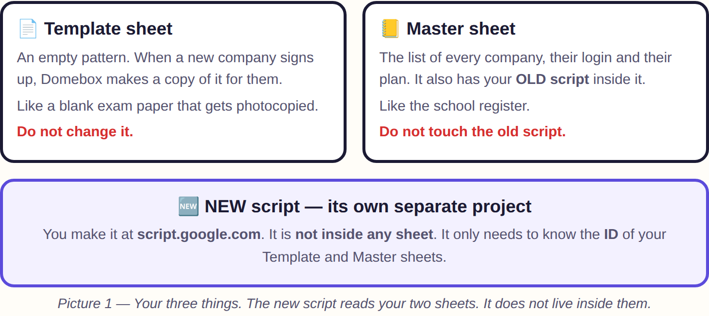

The new script only needs to know the **ID** of your sheets. An ID is like a
sheet's roll number.

### Words used in this book

| Word | Meaning |
|---|---|
| **ID** | The long code in a sheet's web address. See Step 1. |
| **Script** | The program. Your file `code.gs` is a script. |
| **Project** | A box that holds a script. |
| **Run** | Press the ▶ Run button to make the script do one job. |
| **Log** | The messages the script writes after Run. It opens at the bottom. |
| **Script Properties** | A small settings list inside the project, like a notebook. |

### What you need before starting

- [ ] A computer with Google Chrome
- [ ] Log in to Google with the account that owns **info@biscsindia.com**
- [ ] The file **domebox-complete.zip**, unzipped into a folder
- [ ] Your Netlify login and your Razorpay login
- [ ] About 2 hours, with no hurry

There are **two parts**:

- **Part 1 — Practice.** You build the new system next to the old one and test it.
  Customers notice nothing.
- **Part 2 — Switch.** You point the new system at your real Master sheet and
  move the website. 30 minutes.

---

# PART 1 — PRACTICE (customers notice nothing)

## Step 1 — Write down your sheet IDs

1. Open your **Template sheet**.
2. Look at the web address at the top. It looks like this:

   `docs.google.com/spreadsheets/d/`**`1AbC…xyz`**`/edit`

3. The bold part, between **`/d/`** and **`/edit`**, is the **ID**. Copy it.
4. Open Notepad. Write: `Template ID = ` and paste.
5. Do the same for your **Master sheet**. Write: `Master ID = ` and paste.

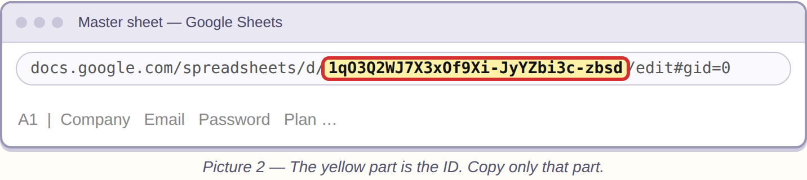

- [ ] I have **Template ID** and **Master ID** in Notepad.

## Step 2 — Make a practice Master sheet

We practise on a **new, empty** sheet, so the real customer list stays safe.

1. Go to **sheets.google.com** → click **Blank** (the big **+**).
2. Click "Untitled spreadsheet" at the top and name it **PRACTICE Master**.
3. Copy its ID (like Step 1). Write in Notepad: `Practice ID = ` and paste.

- [ ] I have **Practice ID** in Notepad.

## Step 3 — Make the NEW script project

1. Go to **script.google.com**.
2. Click **New project** (top left).
3. Click "Untitled project" at the top. Name it **Domebox NEW**.
4. You see a file called `Code.gs` with a few lines in it.
   Click inside it, press **Ctrl + A** (select all), press **Delete**.
5. On your computer, open the folder from the zip → **dist** → **code.gs**.
   Open it with Notepad. Press **Ctrl + A**, then **Ctrl + C** (copy).
6. Go back to the browser. Click inside the empty `Code.gs`. Press **Ctrl + V** (paste).
7. Click the **💾 Save** icon.

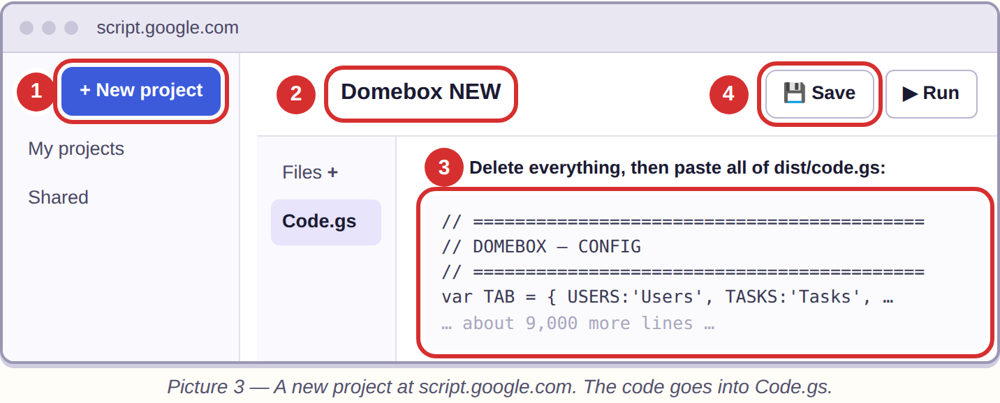

- [ ] The project **Domebox NEW** has the long code in it, and no red lines.

> ❗ You did this at **script.google.com**, NOT inside your Master sheet. Good.

## Step 4 — Fill in the settings notebook

1. On the left side, click the **⚙ gear** (Project Settings).
2. Find **Time zone**. Choose **(GMT+05:30) India Standard Time**.
3. Scroll down to **Script Properties** → click **Add script property**.
4. Add these rows. Left box = **Property**, right box = **Value**:

| Property | Value |
|---|---|
| `MASTER_DB_ID` | your **Practice ID** (from Step 2) |
| `TEMPLATE_ID` | your **Template ID** (from Step 1) |
| `SITE_URL` | `https://www.domebox.in` |
| `MAIL_FROM` | `info@biscsindia.com` |
| `SELLER_LEGAL_NAME` | `BISCS India` |
| `SELLER_ADDRESS` | your office address, in one line |
| `SELLER_STATE` | `West Bengal` |

5. Click **Save script properties**.

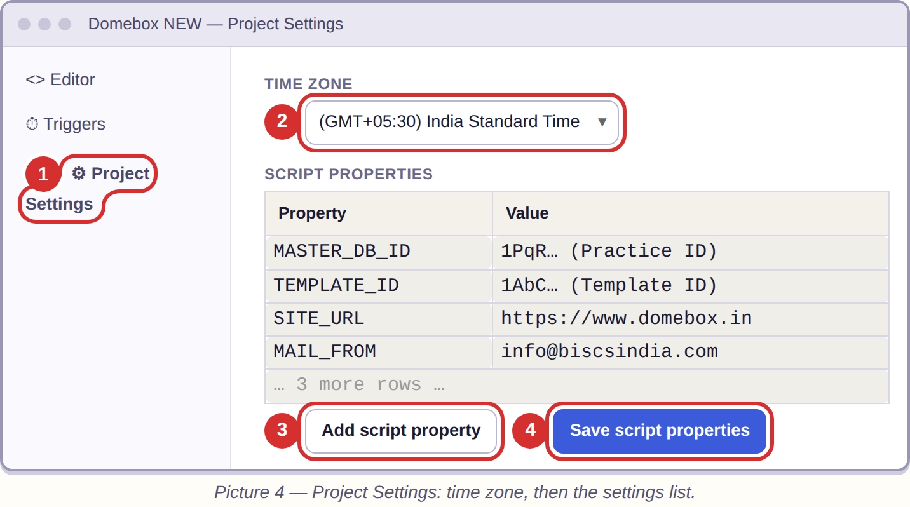

- [ ] Seven rows saved. Time zone is India.

## Step 5 — Run the setup check

1. On the left, click **< >** (Editor).
2. At the top there is a box with a function name. Click it and choose **setupDomeBox**.
3. Click **▶ Run**.
4. Google asks: *Authorization required*. Click **Review permissions** → choose
   your account → **Advanced** → **Go to Domebox NEW (unsafe)** → **Allow**.
   (It says "unsafe" only because you wrote the app yourself. It is fine.)
5. The **Execution log** opens at the bottom. Read it.

You will see some lines with **ok** and some with **MISSING**. That is normal
now. Steps 6–8 fix the MISSING ones.

6. Go back to **⚙ Project Settings** → Script Properties. You will see a new row
   called **AUTH_PEPPER**. **Copy its value into Notepad and keep it safe
   forever.** If it is lost, every customer must reset their password.

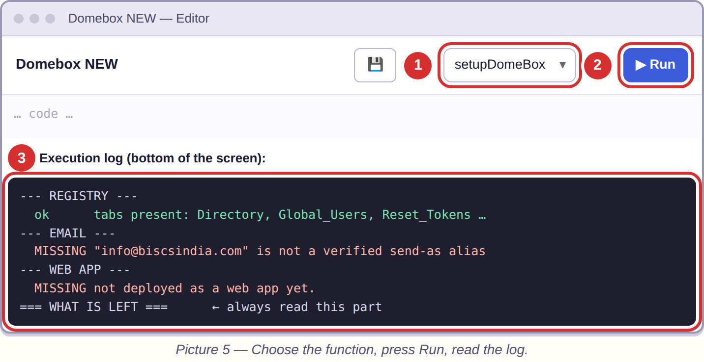

- [ ] setupDomeBox ran. AUTH_PEPPER is saved in Notepad.

## Step 6 — Let it send emails from info@biscsindia.com

Only do this if the log says **"not a verified send-as alias"**.

1. Open **Gmail** → **⚙** → **See all settings** → tab **Accounts and Import**.
2. Find **Send mail as** → **Add another email address**.
3. Type `info@biscsindia.com` → **Next** → follow the steps.
4. Open the email Google sends and click the link.
5. Go back to the script and **Run setupDomeBox** again.

- [ ] The log says: `every email will leave from info@biscsindia.com`

## Step 7 — Put the new script on the internet

1. Top right: **Deploy** → **New deployment**.
2. Click the **⚙** next to *Select type* → choose **Web app**.
3. **Execute as:** Me. **Who has access:** Anyone.
4. Click **Deploy**. Allow if asked.
5. You get a **Web app URL** that ends with **/exec**. Copy it into Notepad as
   `API URL = `.

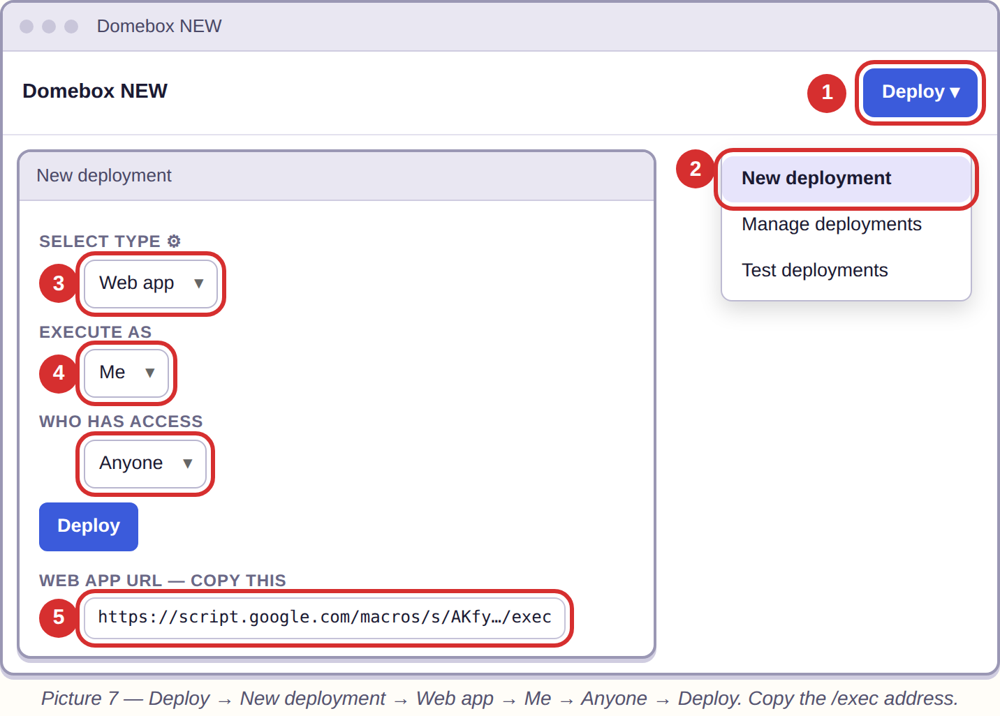

- [ ] I have the **API URL** in Notepad.

> Later, whenever you change the code: **Deploy → Manage deployments → ✏ (pencil)
> → Version: New version → Deploy.** Just pressing Save is NOT enough.

## Step 8 — Add the reminders file

This is a **second file in the same project**. It sends the 9 am, 3 pm and 5 pm
reminders and makes repeating tasks.

1. In the Editor, next to **Files**, click **+** → **Script**. Name it `reminders`.
2. Delete what is inside it.
3. From the zip folder, open **domebox → reminders.gs** in Notepad. Copy all.
   Paste into the new `reminders` file.
4. Near the top, find these two lines and change them:
   - `SHEET_ID: '',` → put your **Practice ID** between the quotes:
     `SHEET_ID: '1AbC…xyz',`
   - `DRY_RUN: true,` → change to `DRY_RUN: false,`
5. Click **💾 Save**.
6. In the function box choose **installDomeBoxSchedules** → **▶ Run**.
7. Choose **setupDomeBox** → **▶ Run**.

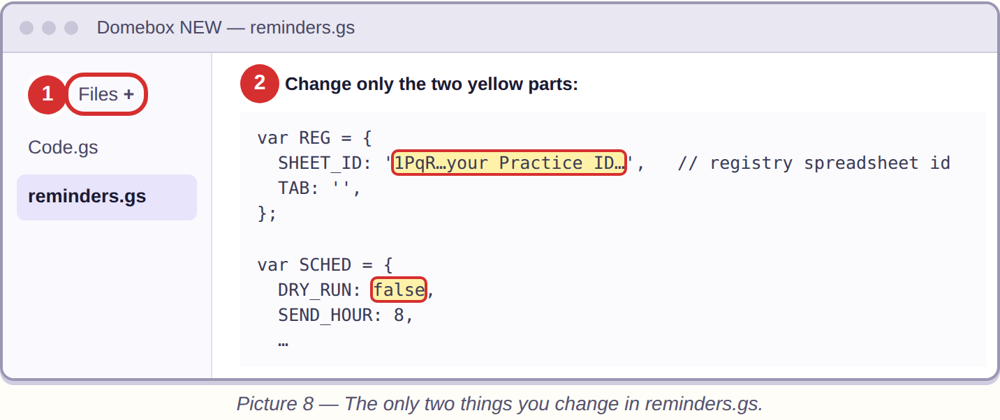

- [ ] The log says: `all scheduled jobs are installed (task reminders at 9, 15 and 17)`

> ❗ Never add the file `payments-secure.gs`. It is old and breaks payments.

## Step 9 — Connect Razorpay — in TEST mode

> ❗ **Do not regenerate your live keys now.** Your old system collects real
> payments with them. Practise with Razorpay's **Test Mode** (pretend money,
> separate keys). Live keys are only touched on switch day (Steps 18 and 20).

1. Razorpay Dashboard → switch **Live Mode → Test Mode** (top of the screen).
2. **Account & Settings** → **API Keys** → **Generate Test Key**. Copy the test
   **Key ID** (`rzp_test_…`) and **Key Secret**.
3. Make up a long password, e.g. `dbx-Hq27-Kolkata-91`. Notepad: `Webhook secret = `
4. Script → **⚙ Project Settings** → Script Properties → add:

| Property | Value |
|---|---|
| `RAZORPAY_KEY_ID` | the **test** Key ID |
| `RAZORPAY_KEY_SECRET` | the **test** Key Secret |
| `RAZORPAY_WEBHOOK_SECRET` | the password you made up |
| `SELLER_GSTIN` | your GST number (skip if not GST registered) |

5. Still in Test Mode: **Webhooks** → **Add New Webhook** → URL = your **API URL**,
   Secret = the made-up password, tick **payment.captured** → **Create**.
6. Run **setupDomeBox** again.

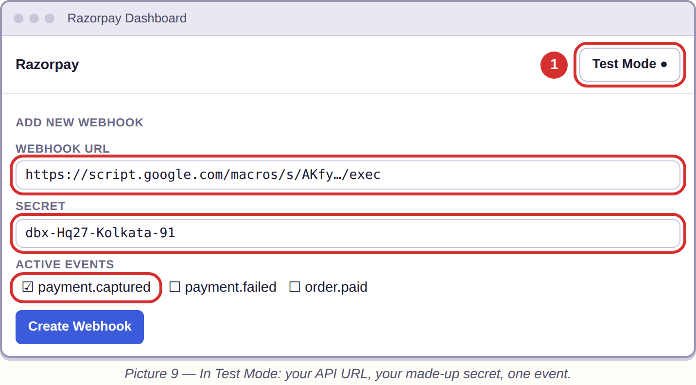

- [ ] No Razorpay line says MISSING. Live keys untouched.

## Step 10 — Make a practice website on Netlify

1. Go to **app.netlify.com** → **Add new site** → **Import an existing project** → **GitHub**.
2. Choose the repository **stockpilot**.
3. Fill in:

| Box | Type this |
|---|---|
| Branch to deploy | `claude/obfuscated-html-content-aywe2k` |
| Base directory | `netlify` |
| Build command | `node build.js` |
| Publish directory | `netlify` |

4. Click **Add environment variables** and add:
   - `API_URL` = your **API URL** (Step 7)
   - `ALLOW_MISSING_LEGAL` = `1` (only for practice — Step 15 removes it)
5. Click **Deploy**. Wait 1–2 minutes until it says **Published**.
6. Click the link that ends in **.netlify.app**.

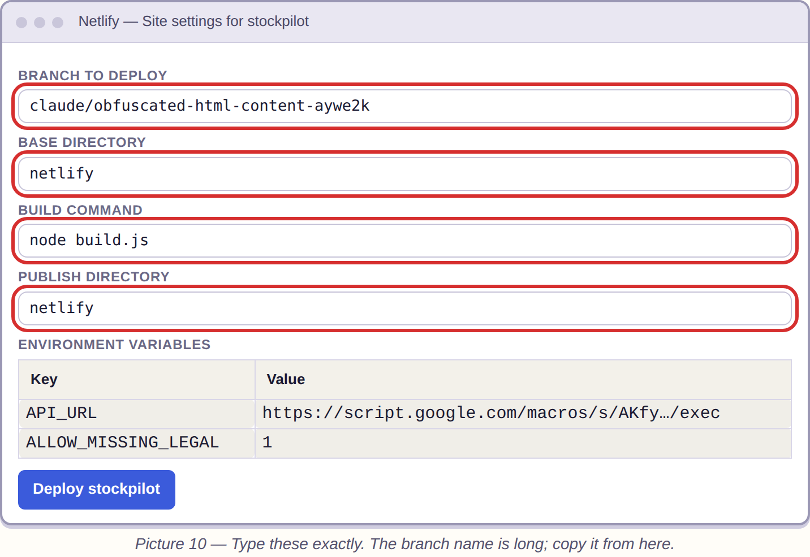

- [ ] The website opens.

## Step 11 — Test it like a customer

On the practice website:

1. **Sign up** a test company, using a second email address you own.
2. Add one team member. Assign them a task.
3. Log out and log in again.
4. Check your email: did the welcome email come from **info@biscsindia.com**?

- [ ] Sign-up, login, task and email all work.

**Part 1 is done.** Your customers still use the old system and noticed nothing.

---

# PART 2 — THE SWITCH (about 45 minutes)

Do this on a quiet day, for example Sunday evening.

## Step 12 — Copy your Master sheet (safety copy)

Open your real **Master sheet** → **File** → **Make a copy**. Name it
**Master BACKUP** and today's date. Do not use it for anything else.

- [ ] Master BACKUP exists.

## Step 13 — Point the NEW script at your REAL Master sheet

1. **Domebox NEW** → **⚙ Project Settings** → Script Properties → change
   `MASTER_DB_ID` from the Practice ID to your **real Master ID**. Save.
2. Open the `reminders` file → change `SHEET_ID` to the same **real Master ID**. Save.
3. Choose **ensureRegistry** → **▶ Run**. (It only adds missing tabs. It never deletes.)

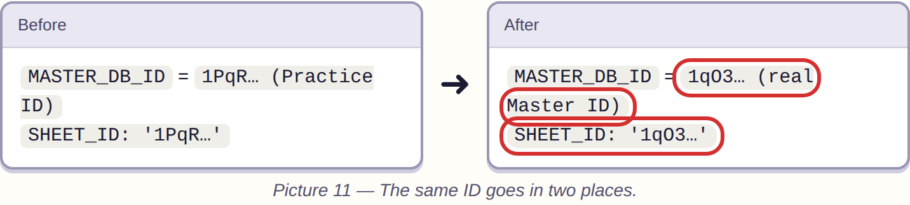

> This does not change your old script. It only tells the new script where the
> real customer list is.

- [ ] Both places have the real Master ID.

## Step 14 — Back up every customer's sheet

1. **Files +** → **Script** → name it `backup`. Paste all of **domebox → backup.gs**. Save.
2. Choose **backupAllTenants** → **▶ Run**. It copies every customer's sheet into
   a Drive folder called **Domebox Backups**. (If it says *Hit MAX_PER_RUN*, run it again.)
3. Choose **verifyLatestBackup** → **▶ Run**.

- [ ] verifyLatestBackup shows no "NO BACKUP AT ALL".

## Step 15 — Fill in your company details for the website

1. **github.com** → repository **stockpilot** → branch button **main** → choose
   `claude/obfuscated-html-content-aywe2k`.
2. Folder **netlify** → **site-config.json** → **✏ pencil**.
3. Fill the 8 empty `""`: address, phone, GSTIN, entity type, registration
   number, grievance officer's name, city, state. **Commit changes**.
4. Netlify (practice site) → **Environment variables** → delete `ALLOW_MISSING_LEGAL`.
5. **Deploys** → **Trigger deploy** → **Deploy site**.

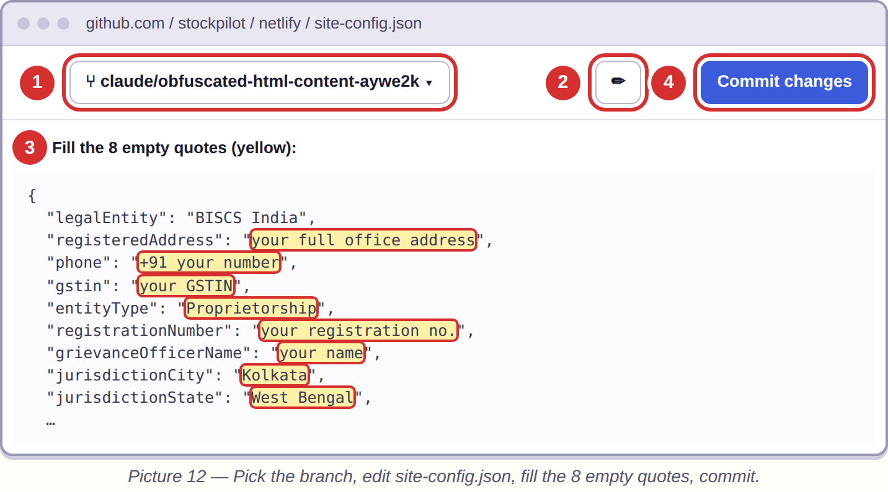

- [ ] Published, and the footer links (Privacy, Terms, Refund, Contact) open.

## Step 16 — Preview the upgrade (changes nothing)

Choose **previewMigration** → **▶ Run**. If there is a **NEEDS A LOOK** section,
someone added an extra column by hand; the log says which. Move that column to
the far right of their Tasks tab and preview again, until it is gone.

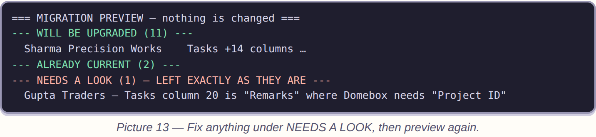

- [ ] No NEEDS A LOOK.

## Step 17 — Do the upgrade

Choose **migrateAllTenants** → **▶ Run**. Every company should be under
**UPGRADED** or **ALREADY CURRENT**. Nothing is deleted; columns and tabs are only added.

- [ ] Every company is UPGRADED or ALREADY CURRENT.

## Step 18 — Give the new script your CURRENT live Razorpay key

The new script uses the same live key your old system uses today, so payments never stop.

1. Open your **Master sheet** → **Extensions → Apps Script** (the OLD script).
   **Ctrl + F** → search `rzp_live`. Copy the Key ID and the Key Secret next to
   it. **Change nothing**, close the tab.
2. **Domebox NEW** → **⚙ Project Settings** → replace the test `RAZORPAY_KEY_ID`
   and `RAZORPAY_KEY_SECRET` with these **live** ones. Save.
3. Razorpay → **Live Mode** → **Webhooks** → **Add New Webhook**: URL = new
   **API URL**, Secret = your made-up password, **payment.captured** → **Create**.
4. Run **setupDomeBox**.

- [ ] Live key in the new script; live webhook to the new API URL.

## Step 19 — Move www.domebox.in to the new website

1. Netlify → **OLD** site → **Domain management** → remove `www.domebox.in` and `domebox.in`.
2. **NEW** site → **Domain management** → **Add a domain** → `www.domebox.in`, then `domebox.in`.
3. Wait for the **🔒 HTTPS** certificate (up to an hour).
4. Open www.domebox.in and log in with your **existing** account and password.

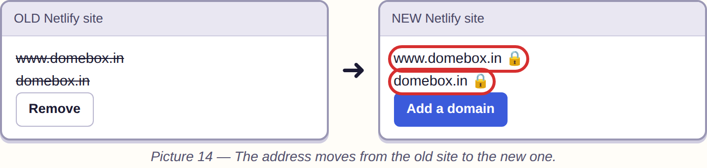

> If something goes wrong: put the domain back on the OLD site. Your old script
> is untouched. Keep it for one week.

- [ ] www.domebox.in shows the new site and your old login works.

## Step 20 — Replace the old Razorpay key with a new one

The old key was written inside the old code, so it must be replaced — but only
now, after the website has moved.

1. Razorpay → **Live Mode** → **Account & Settings** → **API Keys** →
   **Regenerate**. If asked when the old key should stop, **immediately** is fine
   now — nothing uses it any more.
2. Put the new **Key ID** and **Key Secret** into **Domebox NEW** →
   Script Properties. Save. Run **setupDomeBox**.
3. Razorpay → **Webhooks**: if there is an old webhook pointing to the old
   script's address, delete it.
4. Buy the cheapest plan once on www.domebox.in with a real card, then refund it
   from the Razorpay Dashboard.

> Do this **after** Step 19, never before. Regenerating while the old site still
> has the domain stops the old site's payments.

- [ ] New live key in, old key replaced, one real payment worked.

## Step 21 — Close the old "anyone with the link" sharing

1. **Files +** → **Script** → name it `sharing`. Paste **domebox → remediate-sharing.gs**.
2. At the top, `MASTER_DB_ID: '…'` must be your **real Master ID**. Save.
3. **auditSharing** → **▶ Run** (only looks).
4. Change `DRY_RUN: true` to `DRY_RUN: false`. Save. **lockDownAllTenants** → **▶ Run**.
5. **auditSharing** again.

- [ ] Nothing shared publicly.

## Step 22 — Tell your customers

Copy the ready email from **MIGRATING-CUSTOMERS.md** and send it. Same email,
same password for them.

## Step 23 — One week later

1. **previewTaskArchive** → **archiveOldTasks** → **installTaskArchiveSchedule** (once).
2. **createDemoAccount** for sales calls.
3. On GitHub, merge **Pull Request #2** into `main`.

**🎉 Finished.**

---

## If something goes wrong

| You see | Do this |
|---|---|
| Red error when you press Run | Check you chose the right function name in the box. Then Run again. |
| "MASTER_DB_ID is not set" | Step 4 — the Property name must be exactly `MASTER_DB_ID` |
| "not a verified send-as alias" | Step 6 |
| Netlify says **Build failed** | Click the failed deploy. The last lines say what is missing: API_URL or site-config. |
| Website opens but login fails | The API URL in Netlify is wrong, or you forgot **Deploy → New version** after changing code |
| No reminder emails | Step 8: `DRY_RUN: false`, `SHEET_ID` filled, `installDomeBoxSchedules` run, time zone India |
| Emails stop in the afternoon | Free Gmail allows 100 emails a day. Use a Google **Workspace** account. |
| Anything else | Run **setupDomeBox**. Read the last part, **WHAT IS LEFT**. It tells you the next thing to do. |

## Your Notepad should look like this at the end

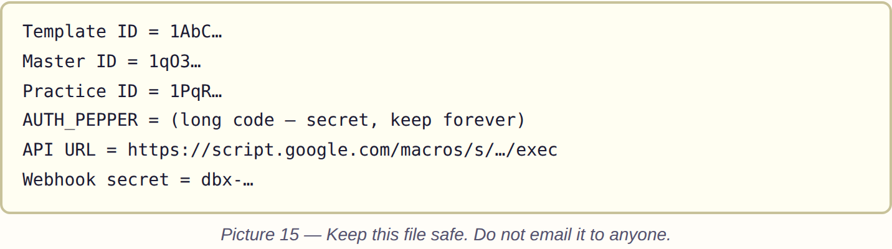

Keep this Notepad file safe. Do not email it to anyone.
